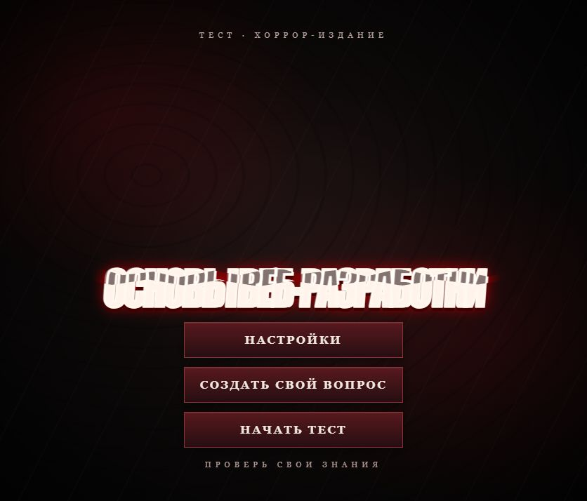
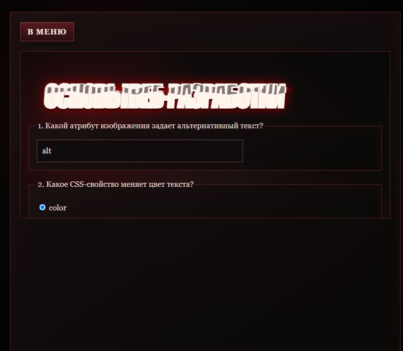
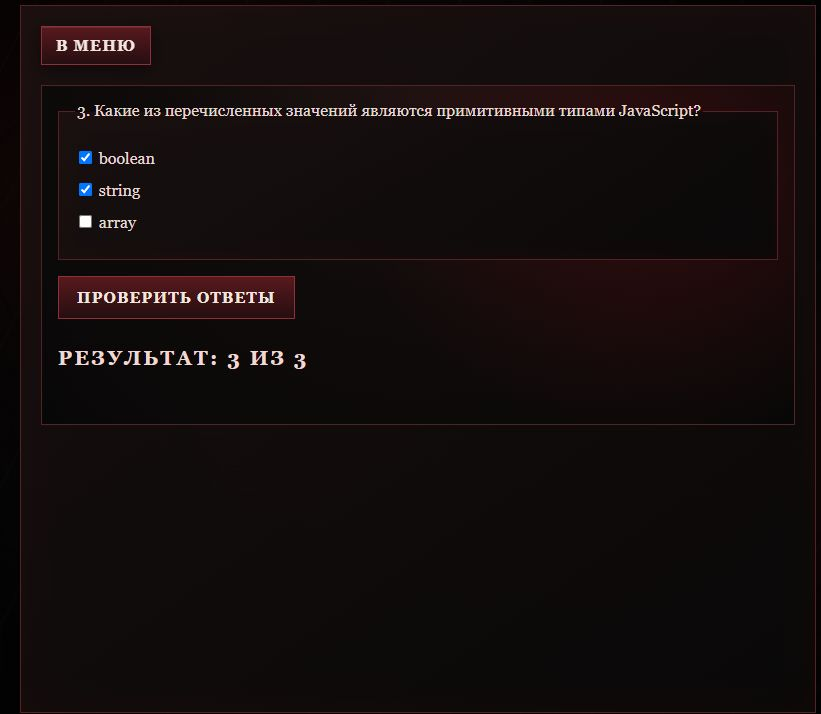

# Quiz Generator: DSL to HTML Form

A Maven module that turns a short text description of a quiz into a working test
form. It reads a domain-specific language (DSL), builds a model, and produces
either a standalone HTML + JavaScript page or a question bank for the web quiz in
`index.html`.

```
quiz.dsl  ──►  parser  ──►  model  ──┬──►  standalone HTML + JS form
                                     └──►  question-bank.js for the web quiz
```

## Features

- **Three question types**: single choice (`r`), multiple choice (`c`) and text
  answer (`t`).
- **Metadata directives**: `Title`, `H1`, `Style`, `Category`.
- **Safe parsing**: the parser never throws on bad input. It returns a partial
  model plus a list of errors with line numbers and stable error codes.
- **Standalone output**: the generated HTML file embeds its own CSS and scoring
  JavaScript. No server, no dependencies, no build step — double-click and play.
- **Question bank export**: the same DSL can feed the interactive web quiz
  (`index.html`) through the generated `question-bank.js`.
- **Tests**: 63 JUnit 5 tests cover the parser, the generator, the exporter, the
  CLI and the DSL/bank consistency.

## Requirements

- JDK 8 or newer (the build targets Java 8);
- Maven 3.6 or newer.

## Build

```bash
mvn clean package
```

The executable jar appears at `target/quiz-dsl-0.1.0-SNAPSHOT.jar`. It is
self-contained: Gson is bundled into the jar, so the command below works on a
machine with only a JRE.

## Usage

### 1. Generate a standalone test form

```bash
java -jar target/quiz-dsl-0.1.0-SNAPSHOT.jar shared/examples/basic.dsl my-test.html
```

```
Готово: my-test.html (3 вопросов)
```

Open `my-test.html` in any browser, answer the questions and press
**Проверить ответы** to see the score.

### 2. Generate the question bank for the web quiz

```bash
java -jar target/quiz-dsl-0.1.0-SNAPSHOT.jar --bank shared/content/web.dsl question-bank.js
```

```
Банк: question-bank.js (9 вопросов)
```

### Exit codes

| Code | Meaning |
|------|---------|
| `0` | Success, the output file was written |
| `1` | Bad arguments, unreadable input or unwritable output |
| `2` | The DSL contains errors, or the quiz has no questions |

On code `2` the output file is **not** created, so a broken description never
produces a broken page.

## Input example

`shared/examples/basic.dsl`:

```
Title My title
H1 Super Test

? 2+2= r
- 4 +
- 5
- 6 e

? Second question c
- A
- B +
- C +e

? Text question t
_ My answer
```

## DSL reference

Metadata directives come before the first question (or between questions):

| Directive | Purpose | Default |
|-----------|---------|---------|
| `Title <text>` | Browser tab title (`<title>`) | empty string |
| `H1 <text>` | Heading shown on the page | empty string |
| `Style <name>` | CSS theme name, exposed as the `test-style-<name>` body class | `default` |
| `Category <name>` | Category for all following questions until the next `Category` | `Общие` |

A question starts with `?`. The answer type is the last token of the line:

```
? How many legs does a cat have? r
- 2
- 4 +
- 6 e
```

| Type | Meaning | Rendered as |
|------|---------|-------------|
| `r` | exactly one correct option | radio buttons |
| `c` | one or more correct options | checkboxes |
| `t` | free-text answer | text input |

Options are lines starting with `-`. A trailing `+` marks the correct option,
and `e` closes the block. Both markers may be attached to the last option
(`- C +e`) or stand alone.

A text question uses `_` for the reference answer:

```
? Which attribute stores alternative text for an image? t
_ alt
```

The answer is compared after trimming surrounding spaces and ignoring case.

The full contract, including every error code, is in [`shared/SPEC.md`](shared/SPEC.md).

## Output example

The form generated from the input above contains three questions: radio buttons,
checkboxes and a text field. The script inside the page scores the answers and
highlights correct and incorrect questions.

### Screenshots







## Web quiz

The interactive version is `index.html`. Questions are loaded from
`question-bank.js`, which is **generated from the DSL**:

```
shared/content/web.dsl  ──►  --bank  ──►  question-bank.js  ──►  index.html
```

Open `index.html` in a browser (or serve the folder with
`python -m http.server`), then:

- **Настройки** sets how many questions to take from each category;
- **Создать свой вопрос** adds a custom question, stored in the browser's
  `localStorage`;
- **Начать тест** builds a randomized quiz.

Do not edit `question-bank.js` by hand: change the questions in
`shared/content/web.dsl` and regenerate the bank. The test
`QuestionBankSyncTest` fails if the two files diverge.

## Project structure

```
src/main/java/com/quiz/
  model/      Quiz, Question, Option, AnswerType
  parser/     DslParser, ParseResult, ParseError, ErrorCode
  generator/  HtmlGenerator (model -> standalone HTML + JS)
  export/     BankExporter (model -> question-bank.js)
  cli/        Main (command line entry point)
src/test/java/com/quiz/   JUnit 5 tests
shared/
  SPEC.md               DSL contract and error table
  examples/basic.dsl    example from the assignment
  content/web.dsl       source of the web quiz questions
index.html              web quiz UI
question-bank.js        generated question bank (do not edit)
```

## Error handling

Errors always carry a line number, a stable code and a human-readable message:

```
Ошибки в DSL:
  Строка 2: не удалось разобрать строку: непонятная строка (UNKNOWN_DIRECTIVE)
```

The parser collects all errors instead of stopping at the first one, so a whole
file can be fixed in one pass.

## Tests

```bash
mvn test
```

The suite covers metadata directives, categories, all three question types,
option markers, every error code, HTML escaping and scoring, the bank format,
the CLI exit codes, and the DSL/bank synchronization.

## Limitations

- No nested questions or blocks.
- Exactly one reference answer per text question.
- Option text cannot end with `+` or `e` unless it is meant as a marker.
- `Style` only sets a body class; the bundled stylesheet styles the `default`
  theme.
- No rich text, images or formulas in questions.
- Custom questions added in the web UI live in `localStorage` and are not
  exported back into the DSL.

## Team

- Core: parser, model, HTML generator, bank exporter, CLI and tests — `GigaSlavik`.
- Web quiz UI: menu, settings, custom questions, randomized selection — `povidlik`.

## License

GNU General Public License v3.0, see [`LICENSE`](LICENSE).
